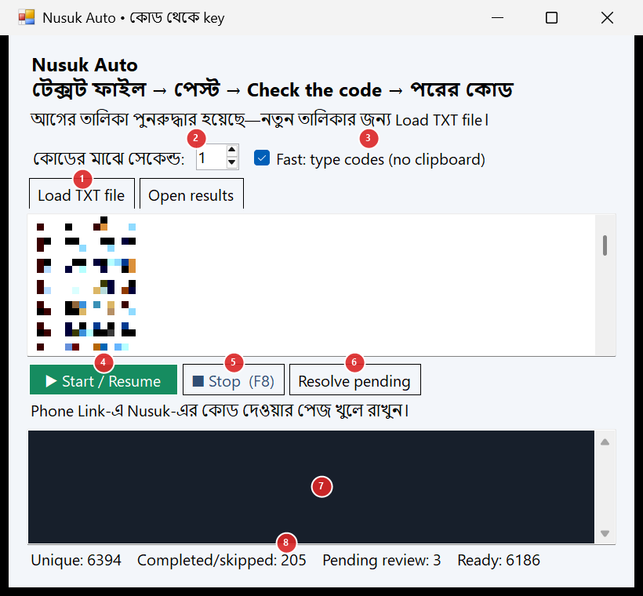
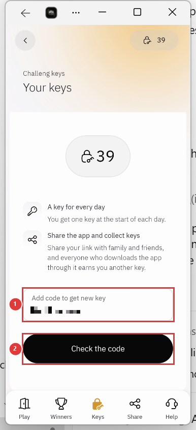
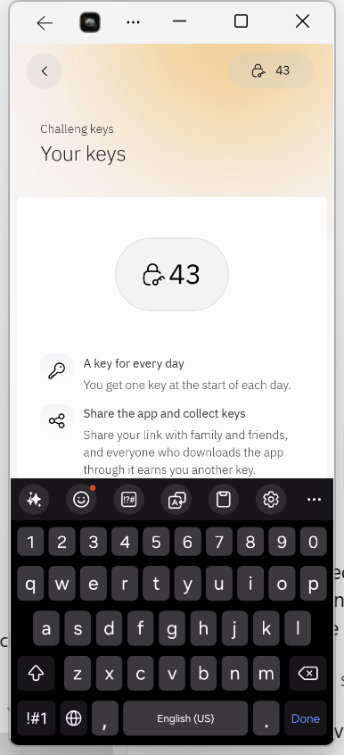

# 🔑 Nusuk Auto

**Nusuk-এ শত শত কোড একটা একটা করে দিতে দিতে ক্লান্ত? কম্পিউটার দিয়ে স্বয়ংক্রিয়ভাবে করুন।**

আপনার কাছে যদি অনেকগুলো `NG-` কোড থাকে, Nusuk Auto সেগুলো একে একে Nusuk অ্যাপে বসাবে, **Check the code** চাপবে, ফলাফল পড়বে আর পরের কোডে যাবে। আপনি শুধু শুরু করে দেবেন। প্রতি কোডে মোটামুটি **৭–১০ সেকেন্ড** লাগে।

নিচে ফোন কানেক্ট থেকে শুরু করে Start, Stop পর্যন্ত সব ধাপ দেওয়া হলো। 👇

---

## সূচিপত্র

- [যা যা লাগবে](#-যা-যা-লাগবে)
- [ধাপ ১: ফোন আর কম্পিউটার কানেক্ট করুন](#-ধাপ-১-ফোন-আর-কম্পিউটার-কানেক্ট-করুন-phone-link)
- [ধাপ ২: ফোনের সেটিংস](#️-ধাপ-২-ফোনের-সেটিংস)
- [ধাপ ৩: কম্পিউটারে Nusuk খুলুন](#️-ধাপ-৩-কম্পিউটারে-nusuk-খুলুন)
- [ধাপ ৪: Nusuk Auto খুলুন আর কোড লোড করুন](#-ধাপ-৪-nusuk-auto-খুলুন-আর-কোড-লোড-করুন)
- [ধাপ ৫: Start](#️-ধাপ-৫-start)
- [ধাপ ৬: Stop / আবার শুরু](#️-ধাপ-৬-stop--আবার-শুরু)
- [ফলাফল কোথায় থাকে](#-ফলাফল-কোথায়-থাকে)
- [সমস্যা ও সমাধান](#-সমস্যা-ও-সমাধান)
- [জরুরি কথা](#️-জরুরি-কথা)

---

## ✅ যা যা লাগবে

- Windows 10 বা 11 কম্পিউটার (Windows-এ English ভাষা থাকতে হবে — স্ক্রিন পড়তে Windows-এর English OCR লাগে)
- Android ফোন (Samsung-এ পরীক্ষা করা)
- ফোনে Nusuk অ্যাপ, লগইন করা
- কম্পিউটারে **Phone Link** অ্যাপ (Windows-এ আগে থেকেই থাকে), ফোনে **Link to Windows** অ্যাপ
- ফোন আর কম্পিউটার একই Wi-Fi-তে
- একটা `.txt` ফাইল, প্রতি লাইনে একটা কোড (যেমন `NG-xxxxxxxx`)
- **Nusuk-Automation.exe** — [Releases](../../releases/latest) পেজ থেকে ডাউনলোড করুন

---

## 📱 ধাপ ১: ফোন আর কম্পিউটার কানেক্ট করুন (Phone Link)

1. কম্পিউটারে Start মেনু থেকে **Phone Link** খুলুন → **Android** বেছে নিন।
2. স্ক্রিনে একটা QR কোড আসবে।
3. ফোনে **Link to Windows** অ্যাপ খুলুন (Samsung-এ *Settings → Connected devices → Link to Windows*) → QR কোড স্ক্যান করুন।
4. ফোনে যত পারমিশন চায় **Allow** দিন।
5. কম্পিউটারের Phone Link-এ **Apps** অংশ চালু আছে কিনা দেখুন — এখান থেকেই ফোনের অ্যাপ কম্পিউটারে খোলা যায়।

---

## ⚙️ ধাপ ২: ফোনের সেটিংস

- **Developer options বন্ধ রাখুন।** চালু থাকলে Nusuk অ্যাপ খোলে না।
- **Screen timeout** সবচেয়ে বেশি সময়ে দিন (*Settings → Display → Screen timeout*), যাতে চলার মাঝে স্ক্রিন বন্ধ না হয়।

---

## 🖥️ ধাপ ৩: কম্পিউটারে Nusuk খুলুন

1. **Phone Link → Apps → Nusuk** খুলুন। কম্পিউটারে `Nusuk` নামে আলাদা একটা উইন্ডো খুলবে।
2. Nusuk-এর **Keys** পেজে যান — যেখানে **Add code to get new key** ঘর আর **Check the code** বাটন আছে।
3. শুধু **একটাই** Nusuk উইন্ডো খোলা রাখুন। উইন্ডো minimize করবেন না, অন্য কিছু দিয়ে ঢাকবেন না।

---

## 🚀 ধাপ ৪: Nusuk Auto খুলুন আর কোড লোড করুন

1. `Nusuk-Automation.exe` চালান।
   > Windows সতর্কবার্তা (SmartScreen) দিলে, ফাইলটি বিশ্বস্ত উৎস থেকে হলে **More info → Run anyway**।
2. **(1) Load TXT file** চাপুন → আপনার কোডের `Nusuk-Codes-1100123406187645-unique.txt` ফাইল বেছে নিন (6000+ Unique key added) । একই কোড দুবার থাকলে একবারই নেবে। আপনার মূল ফাইল বদলায় না।
3. **(2) কোডের মাঝে সেকেন্ড** — দুই কোডের মাঝে বিরতি। `1` দিলেই চলে। Nusuk "too many tries" জাতীয় মেসেজ দিলে বাড়িয়ে দিন।
4. **(3) Fast: type codes** টিক দেওয়া রাখুন। এতে কোড সরাসরি টাইপ হয়, সবচেয়ে দ্রুত।

  
   
  (1) Load TXT file · (2) বিরতি · (3) Fast · (4) Start · (5) Stop · (6) Resolve pending · (7) লগ · (8) হিসাব

---

## ▶️ ধাপ ৫: Start

1. **(4) Start / Resume** চাপুন।
2. ৩ সেকেন্ড পর শুরু হবে। **এই সময় থেকে মাউস আর কীবোর্ড ছোঁবেন না** — টুল নিজেই মাউস-কীবোর্ড চালায়।
3. প্রতিটা কোডের জন্য টুল যা করে:
   - কোডের ঘর খালি করে কোড টাইপ করে
   - স্ক্রিন পড়ে নিশ্চিত হয় কোড হুবহু ঠিক আছে কিনা — না মিললে সাবমিট করে না
   - **Check the code** চাপে, ফলাফল পড়ে
   - সফল হলে **Add another code** চেপে পরের কোড; ভুল/ব্যবহৃত কোড হলে মুছে পরের কোড
4. **(7)** লগে সব দেখা যায়: `SUCCESS`, `REJECTED`, `SKIPPED` ইত্যাদি। **(8)** নিচে মোট, শেষ হওয়া, বাকি কোডের হিসাব।

<table>
  <tr>
    <td align="center"> কোড টাইপ হয়ে গেছে, এরপর Check the code চাপবে</td>
    <td align="center"> ফোনের কীবোর্ড খোলা থাকলেও টুল কাজ করে</td>
  </tr>
</table>

---

## ⏹️ ধাপ ৬: Stop / আবার শুরু

- থামাতে কীবোর্ডে **F8** চাপুন বা **(5) Stop** চাপুন।
- আবার চালাতে **(4) Start / Resume** চাপুন — যেখানে থেমেছিল সেখান থেকেই চলবে। সফল বা বাতিল কোড আর পাঠায় না।
- চলার মাঝে উইন্ডো বন্ধ করলে প্রথম ক্লিকে শুধু থামে, দ্বিতীয় ক্লিকে বন্ধ হয়।
- সব কোড শেষ হলে নিজেই থেমে যায়।

---

## 🧾 ফলাফল কোথায় থাকে

**Open results** চাপলে ফোল্ডার খুলবে:

| ফাইল | কী আছে |
|---|---|
| `results.tsv` | প্রতিটা কোডের ফলাফল (`success` / `rejected` / `typing-failed` …) |
| `skipped-typing.txt` | যেসব কোড ঠিকমতো টাইপ করা যায়নি, সেগুলো হাতে দিতে পারবেন |
| `queue.txt` | লোড করা তালিকা |
| `last-screen.png` | থামার সময়ের শেষ স্ক্রিন (সমস্যা বুঝতে কাজে লাগে) |

---

## ❓ সমস্যা ও সমাধান

| মেসেজ / সমস্যা | কী করবেন |
|---|---|
| **Target lost focus** | চলার মাঝে অন্য উইন্ডো সামনে এসেছে বা আপনি কোথাও ক্লিক করেছেন। Nusuk উইন্ডো সামনে রেখে Start চাপুন। |
| **SKIPPED …** | কোনো কোড হুবহু বসানো যায়নি (যেমন ফোন কোনো অক্ষর বড় হাতের করে দিচ্ছে)। কোডটা `skipped-typing.txt`-এ থাকে, পরের বার আবার চেষ্টা হয়। পরপর ৩টা skip হলে টুল থেমে যায় — তখন ফোন আর Nusuk স্ক্রিন দেখুন। |
| `NG-` এর পরের ছোট হাতের অক্ষর বড় হয়ে যাচ্ছে | ফোনের কীবোর্ড সেটিংসে **Auto capitalize** বন্ধ করে দেখুন। |
| **Pending review** | কোড সাবমিট হয়েছে কিন্তু ফলাফল পড়া যায়নি। Nusuk-এ key বেড়েছে কিনা দেখে **(6) Resolve pending** চাপুন: **Yes** = আর পাঠাবে না, **No** = পরের বার আবার চেষ্টা। |
| **App limit / connection** | Nusuk "too many tries" বা নেটওয়ার্ক সমস্যা দেখাচ্ছে। কিছুক্ষণ পর আবার Start দিন, বিরতি বাড়ান। |

---

## ⚠️ জরুরি কথা

- চলার সময় কম্পিউটার অন্য কাজে ব্যবহার করা যায় না (টুল মাউস-কীবোর্ড চালায়)। বিরতিতে বা রাতে চালিয়ে রাখুন।
- Nusuk-এর নিয়ম মেনে নিজ দায়িত্বে ব্যবহার করুন।
